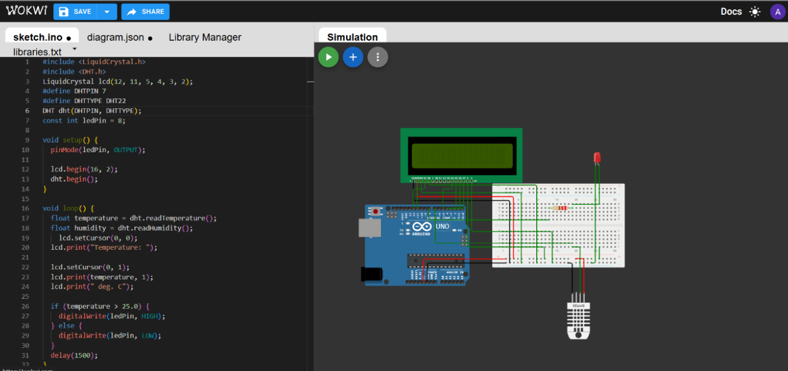
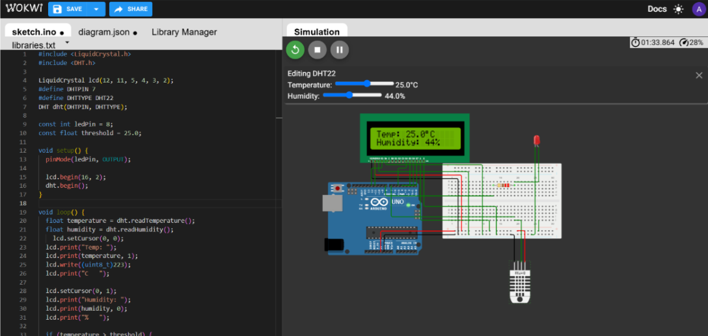
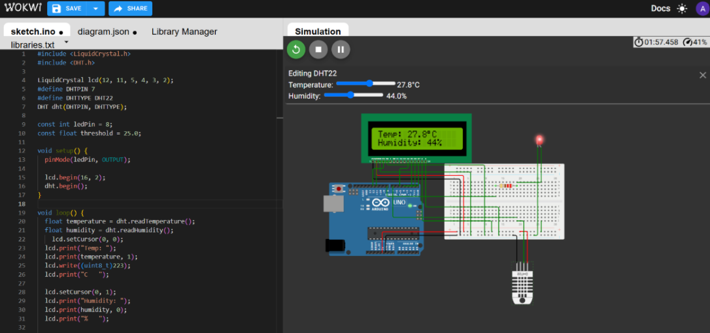

# Temperature Detection and Display

## 1. Task Brief

Design and simulate a circuit that measures temperature using a
temperature sensor and displays the reading on an LCD. When the
temperature exceeds a predefined threshold (25°C), an LED turns on. The
circuit is simulated using [Wokwi](https://wokwi.com/).

## 2. Components Used

-   Arduino Uno
-   DHT22 temperature and humidity sensor
-   16×2 LCD display
-   LED
-   220 Ω resistor
-   Breadboard and jumper wires

## 3. Circuit Design and Connections

### DHT22 Sensor

  DHT22 Pin   Arduino Uno Connection
  ----------- ------------------------
  VCC         5V
  DATA        Digital pin 7
  GND         GND

### 16×2 LCD Display

  LCD Pin                        Arduino Uno Connection
  ------------------------------ ------------------------
  RS                             Digital pin 12
  E                              Digital pin 11
  D4                             Digital pin 5
  D5                             Digital pin 4
  D6                             Digital pin 3
  D7                             Digital pin 2
  VSS                            GND
  RW                             GND
  VDD                            5V
  VO                             GND
  Backlight anode (A / LED+)     5V
  Backlight cathode (K / LED−)   GND

### LED

-   **Anode (long leg):** Digital pin 8 through a 220 Ω resistor
-   **Cathode (short leg):** GND

All components share a common ground.

### Complete Circuit

## 4. Constructing the Project

I built and tested the circuit in the following steps:

1.  Created the power and ground rails.
2.  Connected the LED to the Arduino.
3.  Tested the LED using the basic **Blink** program in the Arduino IDE.
4.  Connected the DHT22 sensor and added the temperature-threshold
    logic.
5.  Tested the LED response at temperatures below and above the
    threshold.
6.  Added the LCD display and completed its connections.
7.  Tested the complete circuit at different temperature values.

## 5. Simulation and Output

### Output 1: Temperature Below the Threshold

At approximately **22°C**, the LCD displays the measured temperature.
Since the temperature is below 25°C, the LED remains **OFF**.

### Output 2: Temperature at the Threshold

At **25°C**, the LED remains **OFF** because the program turns it on
only when the temperature is strictly greater than 25°C.

### Output 3: Temperature Above the Threshold

When the temperature rises above **25°C**, the LED turns **ON**,
indicating that the temperature threshold has been exceeded.

## 6. Conclusion

The simulation demonstrates temperature and humidity monitoring using
the DHT22 sensor and Arduino Uno. The LCD displays the sensor readings,
while the LED provides a visual warning when the temperature exceeds the
specified threshold of 25°C.

## 7. Project Link

**Wokwi Simulation:** 
[Link to Wokwi Simulation](https://wokwi.com/projects/479328975170555905)
